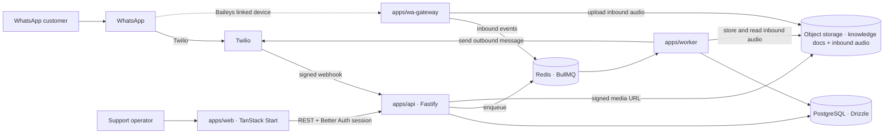

# Architecture

Sanitized system diagram. No real hostnames, IPs, or credentials appear here — see `README.md` for local setup and the `orbit` repository for deployment infrastructure.

## System context

## Component responsibilities

### `apps/api` (Fastify)

- Hosts Better Auth (sign-up, sign-in, invitations, membership).
- Validates Twilio webhook signatures and normalizes inbound WhatsApp messages (`modules/channel-messaging`).
- Owns the support-inbox read/write API: conversation listing with cursor pagination, conversation detail, operator replies, and tenant-scoped short-lived signed media URLs for stored inbound audio (`modules/support-inbox`).
- Accepts text and file content for the knowledge base, supports document title edits and replace/delete actions, and dispatches indexing jobs (`modules/knowledge-base`).
- Provides a side-effect-free knowledge preview that runs an isolated question through the Support Agent graph and returns its decision with optional retrieved sources. Configure `AI_GATEWAY_API_KEY` and `AI_CHAT_MODEL` in `apps/api/.env`; the endpoint returns HTTP 503 when AI Gateway access is unavailable.
- Exposes `/health/live` and `/health/ready`, failing closed when Postgres or Redis is unreachable.
- Runs the Baileys ingress worker with a dedicated Redis connection: `connectTimeout` is retained, but `commandTimeout` is disabled so BullMQ's blocking reads can wait for jobs. The API's shared Redis connection keeps its command timeout.

### `apps/worker`

- Consumes BullMQ jobs defined in `packages/jobs`: `process-inbound-message`, `send-outbound-message`, `fetch-inbound-media`, `transcribe-inbound-audio`, `index-knowledge-document`, plus transactional email jobs.
- Owns Twilio inbound media download into R2, audio transcription, outbound delivery, and knowledge-document indexing side effects.
- Exposes its own `/health/live` and `/health/ready`.

### `apps/wa-gateway`

- Runs the Baileys sessions that own each WhatsApp connection: QR and pairing, session state, reconnects, and inbound/outbound message transport.
- Captures inbound audio by downloading it from the owning socket and uploading the bytes directly to R2, returning the object key to the worker.

### `packages/agent`

- Owns the Support Agent graph, tenant-scoped knowledge retrieval, and the golden-set Eval. The worker invokes its `createSupportAgent` interface after loading the inbound conversation; the worker retains message persistence, handoff, and outbound-job ownership.

### `apps/web`

- TanStack Start operator interface on Cloudflare Workers: authentication flows, the `/inbox` and `/inbox/$conversationId` support views, and `/settings` (members and knowledge base). The inbox timeline renders audio Messages with their transcript and resolves playback through the signed media URL endpoint. Knowledge-base management is restricted to organization owners and admins at `/settings/knowledge`; the question preview is a separate tab on that page. Dashboard data is loaded on the client through React Query and a WebSocket to `apps/api`.

### Shared packages

- `packages/domain`: shared contracts and ULID generation, consumed by both API and worker.
- `packages/db`: Drizzle schema (`auth`, `support`, `knowledge`) and the Postgres client.
- `packages/jobs`: BullMQ job names, Zod schemas, and queue names shared between producer (API) and consumer (worker).
- `packages/config`, `packages/logger`, `packages/messaging`, `packages/object-storage`, `packages/email`: cross-cutting server concerns.
- `packages/ui`: shared UI primitives for `apps/web`.

## Data flow: inbound WhatsApp message

1. Twilio POSTs the inbound message to `apps/api`, which verifies the request signature against `PUBLIC_API_URL`. Baileys sessions in `apps/wa-gateway` send their messages through the `wa-ingress` queue to the same ingestion path.
2. The API normalizes the payload, persists the Message, and enqueues `process-inbound-message` with a deterministic job ID keyed by `messageId` (idempotent redelivery). Audio Messages enqueue `fetch-inbound-media` instead.
3. `apps/worker` picks up the job, applies conversation-threading logic, and persists the resulting support-conversation state.
4. The operator sees the new/updated conversation in `apps/web` via the support-inbox API.
5. An operator reply enqueues `send-outbound-message`, which the worker delivers back through the Channel adapter.

### Audio branch

1. The API persists the audio Message with a `message_media` row in `pending` and enqueues `fetch-inbound-media`.
2. The worker obtains the bytes: it downloads Twilio media with the decrypted account credentials, or asks `apps/wa-gateway` to download Baileys media. The worker or gateway stores the bytes in R2, and `message_media` moves to `stored`.
3. The worker enqueues `transcribe-inbound-audio`, which calls the AI Gateway transcription endpoint and writes the transcript into `messages.body` with `transcript_status = 'completed'`.
4. The worker enqueues `process-inbound-message`, so the agent reads the transcript and continues the normal inbound flow.
5. If download or transcription fails permanently, the worker records the failure in `message_media` and an audit event. The inbound flow then degrades the conversation to `human_required` with reason `transcription_failed`.

## Known boundaries

- Channel provisioning (`channel:provision:twilio`) is an internal CLI operation today; Meta Embedded Signup is not yet implemented.
- The worker contains the Support Agent graph for inbound first-line responses. This describes code, not a verified production deployment.
- This diagram describes the codebase's own architecture, not any specific deployment's current operational status.
